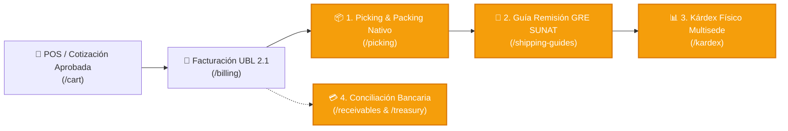

# 🚀 Plan Maestro de Implementación: Módulos Faltantes ERP CHOHO Perú

> **Documento de Arquitectura y Hoja de Ruta Técnica**  
> **Sistema**: ERP Comercial, Financiero y Logístico CHOHO Perú  
> **Objetivo**: Cerrar el ciclo operativo integral (Ventas ➡️ Almacén ➡️ GRE SUNAT ➡️ Kárdex ➡️ Tesorería) de forma 100% nativa.

---

## 📌 Diagnóstico y Aclaración de Alcance

Queda registrado que la aplicación móvil `Picking\picking_carmelita` pertenece a otra empresa y entorno de trabajo. Para **CHOHO Perú**, se implementará una solución **100% nativa y desacoplada** dentro del mismo stack tecnológico (`React + TypeScript + TailwindCSS + Express + MySQL/SQLite + Lucide`), optimizada para pantallas táctiles de almacén, terminales PDA/pistolas lectoras y computadoras de despacho.



---

## 🏗️ Desglose de los 4 Módulos Faltantes

---

### Módulo 1: Picking & Empaque Nativo (Almacén y Despacho)

#### 🎯 Propósito
Digitalizar y controlar la preparación de pedidos en el almacén de CHOHO Perú para evitar discrepancias entre lo cotizado/facturado y lo físicamente despachado.

#### ⚙️ Flujo Operativo
1. **Cola de Pedidos en Vivo**: Al aceptar una cotización o emitir una factura, se genera automáticamente una `Orden de Picking` en estado `PENDIENTE`.
2. **Terminal de Almacén (Responsive / PDA)**:
   - Pantalla táctil de alto contraste diseñada para operarios con guantes o lectores de código de barras.
   - Modo escaneo continuo: cada lectura del SKU o código de barra suma +1 a la cantidad recogida, con feedback sonoro (beep de éxito / error si el SKU no corresponde).
3. **Control de Bultos & Pesos**:
   - Agrupación en Cajas/Sacos con generación de etiqueta interna (Bulto 1 de N, Peso Kg, SKU contenidos).
   - Asignación de precintos de seguridad para envíos a provincia.
4. **Cierre de Preparación**: Al completar el 100% de los ítems, la orden pasa a `EMPACADO` y habilita automáticamente la emisión de la Guía de Remisión.

#### 🗄️ Esquema de Base de Datos
```sql
CREATE TABLE IF NOT EXISTS picking_orders (
  id VARCHAR(50) PRIMARY KEY,
  quote_id VARCHAR(50),
  invoice_id VARCHAR(50),
  branch VARCHAR(100) NOT NULL DEFAULT 'Sede Lima',
  operator VARCHAR(150),
  status VARCHAR(30) DEFAULT 'PENDIENTE', -- PENDIENTE, EN_PROCESO, COMPLETADO, OBSERVADO
  total_packages INT DEFAULT 1,
  total_weight_kg DECIMAL(10,2) DEFAULT 0,
  started_at DATETIME,
  completed_at DATETIME,
  created_at DATETIME DEFAULT CURRENT_TIMESTAMP
);

CREATE TABLE IF NOT EXISTS picking_items (
  id INT AUTO_INCREMENT PRIMARY KEY,
  picking_id VARCHAR(50) NOT NULL,
  sku VARCHAR(50) NOT NULL,
  name VARCHAR(255) NOT NULL,
  ordered_qty INT NOT NULL,
  picked_qty INT DEFAULT 0,
  is_verified TINYINT(1) DEFAULT 0,
  FOREIGN KEY (picking_id) REFERENCES picking_orders(id) ON DELETE CASCADE
);
```

#### 🖥️ Interfaz de Usuario
- **Ruta**: `/picking` (Permiso: `userPermissions.inventory` o nuevo `userPermissions.picking`).
- **Componente**: `src/components/PickingManager.tsx`.
- **Características**: Selector de sede, buscador por código de barras, barra de progreso porcentual por pedido, botón "Completar y Generar GRE".

---

### Módulo 2: Guía de Remisión Electrónica SUNAT (GRE - Remitente)

#### 🎯 Propósito
Cumplimiento estricto de la normativa de SUNAT (R.S. 000123-2022 y modificatorias) para el traslado de cadenas de transmisión, catalinas, piñones y repuestos pesados a nivel nacional.

#### ⚙️ Flujo Operativo
1. **Extracción de Datos**: Al finalizar el picking, el sistema precarga los datos de los ítems, bultos, remitente (CHOHO Perú) y destinatario (Cliente validado con Peru API).
2. **Selección de Modalidad de Traslado**:
   - **Modalidad Pública (Agencias)**: Selección de agencia transportista (RUC y Razón Social de Shalom, Marvisur, Cavassa, Flores Hnos, etc.).
   - **Modalidad Privada (Flota Propia)**: Datos de la unidad (Placa del vehículo MTC, Récord del conductor, Licencia de conducir Brevete, Chofer).
3. **Puntos de Partida y Llegada**:
   - Ubigeo de almacén emisor (Ej: 150101 Lima) y dirección física.
   - Ubigeo de entrega o terminal de agencia en destino provincial.
4. **Generación UBL 2.1 GRE**:
   - Emisión de serie oficial `T001-XXXX` (o `EG01-XXXX`).
   - Construcción del XML UBL 2.1 con motivo de traslado (01 Venta, 04 Traslado entre sedes).
   - Generación del Código Hash y QR imprimible en formato A4 / Ticket térmico.

#### 🗄️ Esquema de Base de Datos
```sql
CREATE TABLE IF NOT EXISTS shipping_guides (
  id VARCHAR(50) PRIMARY KEY, -- Ej: T001-00000124
  picking_id VARCHAR(50),
  invoice_id VARCHAR(50),
  issue_date DATETIME DEFAULT CURRENT_TIMESTAMP,
  transfer_date DATE NOT NULL,
  transport_mode VARCHAR(20) NOT NULL, -- PUBLICO / PRIVADO
  transfer_reason VARCHAR(10) NOT NULL DEFAULT '01', -- 01 Venta, 04 Traslado entre sedes
  
  -- Transportista Publico (Agencia)
  carrier_ruc VARCHAR(20),
  carrier_name VARCHAR(255),
  
  -- Transporte Privado (Chofer / Vehiculo)
  driver_doc_type VARCHAR(10),
  driver_doc_number VARCHAR(20),
  driver_name VARCHAR(150),
  driver_license VARCHAR(30),
  vehicle_plate VARCHAR(20),
  
  -- Puntos de Traslado
  origin_ubigeo VARCHAR(10) NOT NULL,
  origin_address VARCHAR(255) NOT NULL,
  destination_ubigeo VARCHAR(10) NOT NULL,
  destination_address VARCHAR(255) NOT NULL,
  
  -- Carga
  total_weight_kg DECIMAL(10,2) NOT NULL,
  packages_count INT NOT NULL,
  
  -- Estados SUNAT
  sunat_status VARCHAR(30) DEFAULT 'ACEPTADO',
  hash VARCHAR(255),
  xml_data LONGTEXT,
  cdr_data LONGTEXT
);
```

#### 🖥️ Interfaz de Usuario
- **Ruta**: `/shipping-guides`.
- **Componente**: `src/components/ShippingGuideManager.tsx`.
- **Características**: Generador modal con autocompletado de agencias, vista previa del formato oficial de Guía SUNAT, descarga de XML y PDF.

---

### Módulo 3: Kárdex Físico Multisede & Transferencias Internas

#### 🎯 Propósito
Evitar quiebres de stock y descuadres entre sedes (Lima, Arequipa, Trujillo, Huancayo), garantizando que cada venta o traslado descuente existencias en la sede física correspondiente.

#### ⚙️ Flujo Operativo
1. **Stock Descentralizado por Sede**:
   - Reemplazar la columna única `products.stock` por una matriz de inventario real vinculada a las sedes (`branches`).
2. **Kárdex Permanente (Auditable)**:
   - Registro inmutable por cada SKU con saldo anterior, entrada/salida y saldo posterior.
   - Tipo de movimiento:
     - `ENTRADA_COMPRA`: Recepción de contenedor / proveedor.
     - `SALIDA_VENTA`: Despacho por factura / picking.
     - `SALIDA_TRANSFERENCIA`: Envío desde Almacén Central Lima hacia provincia.
     - `ENTRADA_TRANSFERENCIA`: Confirmación de recepción en Sede Destino.
     - `AJUSTE_INVENTARIO`: Merma, daño o regularización de inventario físico.
3. **Módulo de Transferencias Internas**:
   - Solicitud de reabastecimiento generada por la sede provincial.
   - Autorización por el Jefe de Almacén Central.
   - Despacho con Guía de Remisión interna (Motivo 04: Traslado entre establecimientos de la misma empresa).

#### 🗄️ Esquema de Base de Datos
```sql
CREATE TABLE IF NOT EXISTS branch_stock (
  id INT AUTO_INCREMENT PRIMARY KEY,
  branch_name VARCHAR(100) NOT NULL,
  sku VARCHAR(50) NOT NULL,
  stock INT NOT NULL DEFAULT 0,
  min_stock INT DEFAULT 5,
  location_rack VARCHAR(50),
  UNIQUE KEY uk_branch_sku (branch_name, sku),
  FOREIGN KEY (sku) REFERENCES products(sku) ON DELETE CASCADE
);

CREATE TABLE IF NOT EXISTS kardex_movements (
  id INT AUTO_INCREMENT PRIMARY KEY,
  branch_name VARCHAR(100) NOT NULL,
  sku VARCHAR(50) NOT NULL,
  movement_type VARCHAR(50) NOT NULL, -- ENTRADA_COMPRA, SALIDA_VENTA, TRANSFERENCIA_SALIDA, TRANSFERENCIA_ENTRADA, AJUSTE
  document_reference VARCHAR(100), -- F001-00012, T001-00045, etc.
  initial_stock INT NOT NULL,
  quantity INT NOT NULL, -- Positivo o negativo
  final_stock INT NOT NULL,
  unit_cost DECIMAL(10,2) DEFAULT 0,
  operator VARCHAR(150) NOT NULL,
  created_at DATETIME DEFAULT CURRENT_TIMESTAMP,
  FOREIGN KEY (sku) REFERENCES products(sku)
);

CREATE TABLE IF NOT EXISTS branch_transfers (
  id VARCHAR(50) PRIMARY KEY,
  origin_branch VARCHAR(100) NOT NULL,
  destination_branch VARCHAR(100) NOT NULL,
  guide_number VARCHAR(50),
  status VARCHAR(30) DEFAULT 'EN_TRANSITO', -- SOLICITADO, EN_TRANSITO, RECIBIDO, RECHAZADO
  items JSON NOT NULL,
  requested_by VARCHAR(150) NOT NULL,
  received_by VARCHAR(150),
  created_at DATETIME DEFAULT CURRENT_TIMESTAMP
);
```

#### 🖥️ Interfaz de Usuario
- **Ruta**: `/kardex` y actualización de `/inventory`.
- **Componente**: `src/components/KardexManager.tsx` e integración en el terminal POS (el POS filtrará stock según la sede del usuario conectado).

---

### Módulo 4: Conciliación Bancaria & Validación Antifraude de Amortizaciones

#### 🎯 Propósito
Garantizar que todas las ventas al crédito registradas en Cuentas por Cobrar (`/receivables`) solo se cancelen con vouchers y operaciones bancarias legítimas y no reutilizadas.

#### ⚙️ Flujo Operativo
1. **Catálogo de Cuentas Bancarias de la Empresa**:
   - Registro de cuentas recaudadoras oficiales de CHOHO Perú (BCP Soles, BBVA Soles, Interbank Dólares, etc.) con sus respectivos CCI y monedas.
2. **Registro de Amortización Mejorado**:
   - Selección obligatoria del banco receptor y medio de pago (Transferencia, Depósito en Ventanilla, Yape/Plin, Cheque).
   - Ingreso del **Número de Operación Bancaria**.
   - Carga de imagen o comprobante del voucher bancario.
3. **Mecanismo Antiduplicidad (Antifraude)**:
   - Validación automática en tiempo real: si el par `(banco, numero_operacion)` ya existe en cualquier amortización anterior, el sistema bloquea el registro e informa la cotización/factura donde ya fue usado.
4. **Bandeja de Aprobación de Tesorería**:
   - El cobrador/asesor registra el abono en estado `PENDIENTE_VERIFICACION`.
   - El personal de finanzas/contabilidad coteja el extracto bancario y marca `CONCILIADO` o `OBSERVADO`.

#### 🗄️ Esquema de Base de Datos
```sql
CREATE TABLE IF NOT EXISTS company_bank_accounts (
  id VARCHAR(50) PRIMARY KEY,
  bank_name VARCHAR(100) NOT NULL, -- BCP, BBVA, Interbank, Scotiabank, BanBif
  account_number VARCHAR(100) NOT NULL,
  cci VARCHAR(100),
  currency VARCHAR(10) DEFAULT 'PEN',
  account_type VARCHAR(50) DEFAULT 'Corriente',
  status VARCHAR(20) DEFAULT 'Activo'
);

-- Actualización de la tabla payments existente:
ALTER TABLE payments ADD COLUMN bank_id VARCHAR(50);
ALTER TABLE payments ADD COLUMN payment_method VARCHAR(50) DEFAULT 'Transferencia';
ALTER TABLE payments ADD COLUMN operation_number VARCHAR(100);
ALTER TABLE payments ADD COLUMN voucher_image LONGTEXT;
ALTER TABLE payments ADD COLUMN reconciliation_status VARCHAR(30) DEFAULT 'CONCILIADO';
ALTER TABLE payments ADD COLUMN verified_by VARCHAR(150);
ALTER TABLE payments ADD COLUMN verified_at DATETIME;
```

#### 🖥️ Interfaz de Usuario
- **Ruta**: Pestaña integrada en `/receivables` ("Conciliación Bancaria y Amortizaciones") y `/admin` ("Cuentas Bancarias").
- **Componente**: Modal de amortización enriquecido en `src/components/AccountsReceivable.tsx`.

---

## 🗓️ Cronograma y Fases de Ejecución

| Fase | Módulo | Entregables Principales | Duración Estimada |
| :--- | :--- | :--- | :---: |
| **Fase 1** | **Picking & Packing Nativo** | Tablas `picking_*`, endpoints API de almacén, componente `PickingManager.tsx` con soporte para escáneres láser y empaque de bultos. | 2 a 3 días |
| **Fase 2** | **Guías de Remisión GRE SUNAT** | Tablas `shipping_guides`, generador XML UBL 2.1 GRE, modalidades Privada/Pública (Agencias Shalom/Marvisur), visor de GRE y QR. | 2 a 3 días |
| **Fase 3** | **Kárdex Físico Multisede** | Migración a `branch_stock`, disparadores de Kárdex ante despachos y compras, componente `KardexManager.tsx` y transferencias entre sedes. | 2 a 3 días |
| **Fase 4** | **Conciliación Bancaria** | Tabla `company_bank_accounts`, validación anti-duplicados de N° de operación bancaria, carga de voucher en `/receivables`. | 1 a 2 días |
| **Fase 5** | **Integración E2E & Playwright** | Pruebas end-to-end completas desde la cotización POS hasta el despacho, GRE y cobro bancario. | 1 día |

---

## 🛡️ Beneficios para CHOHO Perú
1. **Independencia Total**: No depende de aplicaciones de terceros ni de soluciones creadas para otras empresas.
2. **Cero Quiebres de Stock**: La reserva y el descuento de inventario son fieles a la sede física donde está el producto.
3. **Blindaje Legal ante SUNAT**: Traslados respaldados con Guías Electrónicas válidas, previniendo decomisos de mercadería en garitas o agencias.
4. **Seguridad Financiera**: Imposibilidad de que cobradores reutilicen un voucher bancario para justificar dos ventas distintas.
